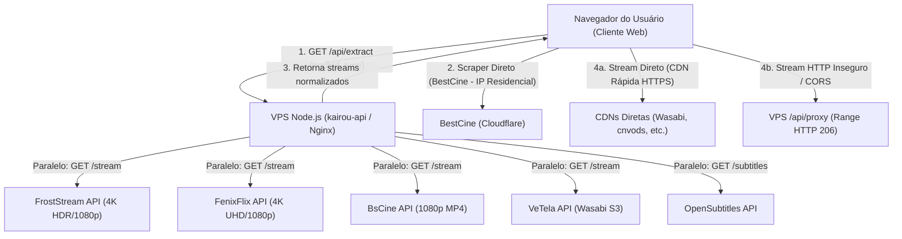

# 🎬 Kairou Streaming — Especificação Técnica da Arquitetura do Backend

Documento completo para contexto de desenvolvimento, inteligência artificial e engenharia de software sobre como funciona o backend de streaming e extração de filmes/séries da plataforma **Kairou** (https://www.kairou.space).

---

## 1. Visão Geral da Arquitetura

O Kairou utiliza uma **arquitetura híbrida de alto desempenho**:
* **Backend VPS (Node.js + PM2 + Nginx)**: Hospedado no servidor dedicado `217.217.235.211`, executando o processo `kairou-api` e servindo como Turbo Proxy HLS/MP4, resolvedor de IDs TMDB/IMDb, extrator server-side e normalizador de CORS.
* **Cliente Web (React 18 + Vite)**: Executa no navegador do usuário e atua como cliente de mídia com player HTML5/HLS.js próprio, além de executar chamadas de extração direta (*client-side scrapers*) para provedores protegidos por Cloudflare anti-datacenter.



---

## 2. Mapa de Arquivos no Código-Fonte

* **Servidor HTTP & Roteador Principal**:
  [`server/server.js`](file:///c:/Users/shizu/Downloads/kai2/server/server.js)
  * Servidor HTTP nativo Node.js escutando na porta `3001` (gerenciado por PM2 e exposto via Nginx em `https://www.kairou.space`).
  * Roteia `/api/extract`, `/api/proxy`, `/api/channels` e serve arquivos estáticos de `dist/`.
* **Motor de Extração e Raspagem Server-Side**:
  [`api/extract.js`](file:///c:/Users/shizu/Downloads/kai2/api/extract.js)
  * Responsável por consultar múltiplos provedores Stremio em paralelo (`Promise.allSettled`), resolver IDs externos, filtrar qualidade, detectar áudio (Dublado/Legendado/Dual) e retornar streams formatados com prioridade 1080p.
* **Turbo Proxy de Mídia & Conversor de Legendas**:
  [`api/proxy.js`](file:///c:/Users/shizu/Downloads/kai2/api/proxy.js)
  * Faz bypass de CORS, converte streams HTTP em HTTPS para eliminar erros de *Mixed Content*, suporta requisições parciais `Range: bytes=x-y` (HTTP 206) para busca de vídeo instantânea e converte `.srt` em `WEBVTT` em tempo real.
* **Serviço de Extração do Cliente (Híbrido)**:
  [`src/services/extractor.js`](file:///c:/Users/shizu/Downloads/kai2/src/services/extractor.js)
  * Coordena a extração combinada: busca na API da VPS e dispara a chamada do cliente para o BestCine (usando IP residencial para contornar bloqueios de datacenter da Cloudflare).
* **Player Nativo de Vídeo**:
  [`src/components/VideoPlayer.jsx`](file:///c:/Users/shizu/Downloads/kai2/src/components/VideoPlayer.jsx)
  * Player customizado sem iframes de anúncios, com suporte a HLS nativo/HLS.js, seletor de áudio e legendas, medidor de velocidade (*ping latency tester*), troca manual para 4K e fallback automático de proxy.
* **Serviço de Metadados e IDs TMDB**:
  [`src/services/tmdb.js`](file:///c:/Users/shizu/Downloads/kai2/src/services/tmdb.js)
  * Consulta catálogo oficial do TMDB (sinopse, elenco, trailer, notas) e converte IDs TMDB em IDs IMDb (`tt...`).

---

## 3. Provedores de Streaming Conectados (APIs Upstream)

Todos os provedores adotam a convenção de rotas do protocolo de add-ons do Stremio:
`GET {baseUrl}/stream/{type}/{id}.json`

### 1. FrostStream
* **Base URL**: `https://froststream.cloutteam.com`
* **Filmes**: `GET https://froststream.cloutteam.com/stream/movie/{imdbId}.json`
* **Séries**: `GET https://froststream.cloutteam.com/stream/series/{imdbId}:{season}:{episode}.json`
* **Velocidade**: `~230ms`
* **Características**: Entrega links diretos MP4/HLS em **4K HDR** e **1080p**, com foco estrito em dublagem brasileira e áudio original de alta qualidade.

### 2. FenixFlix
* **Base URL**: `https://fenixflix.fenixhub.online`
* **Filmes**: `GET https://fenixflix.fenixhub.online/stream/movie/{id}.json` (aceita `tt...` e `tmdb:...`)
* **Séries**: `GET https://fenixflix.fenixhub.online/stream/series/{id}:{season}:{episode}.json`
* **Velocidade**: `~270ms`
* **Características**: Catálogo extenso de produções mundiais em 4K e 1080p Full HD.

### 3. BestCine
* **Base URL**: `https://bestcine.dpdns.org`
* **Filmes**: `GET https://bestcine.dpdns.org/stream/movie/{id}.json`
* **Séries**: `GET https://bestcine.dpdns.org/stream/series/{id}:{season}:{episode}.json`
* **Importante**: Em séries, a consulta com `tmdb:{tmdbId}:{s}:{e}.json` entrega mais de 40 fontes por episódio. Devido ao Cloudflare anti-bot, essa requisição é executada diretamente pelo navegador do cliente no frontend (`src/services/extractor.js`).

### 4. BsCine
* **Base URL**: `https://bscine.alwaysdata.net`
* **Filmes**: `GET https://bscine.alwaysdata.net/stream/movie/{imdbId}.json`
* **Séries**: `GET https://bscine.alwaysdata.net/stream/series/{imdbId}:{season}:{episode}.json`
* **Velocidade**: `~380ms`
* **Características**: Entrega streams diretos MP4 em 1080p Full HD Dublado e Legendado.

### 5. Vê Tela (VeTela)
* **Base URL**: `https://addon.thsolucoes.site`
* **Filmes**: `GET https://addon.thsolucoes.site/stream/movie/{id}.json`
* **Séries**: `GET https://addon.thsolucoes.site/stream/series/{id}:{season}:{episode}.json`
* **Velocidade**: `~460ms`
* **Características**: Links em storages Wasabi S3 e CDNs compatíveis com MP4 rápido.

---

## 4. Endpoints do Backend

### A. Extrator de Mídia: `GET /api/extract`

#### Parâmetros de Requisição:
| Parâmetro | Tipo | Obrigatório | Descrição |
| :--- | :--- | :--- | :--- |
| `tmdbId` | `number` | Sim (ou `imdbId`) | ID do título no TheMovieDatabase (ex: `533535`) |
| `imdbId` | `string` | Opcional | ID do título no IMDb (ex: `tt6263850`) |
| `type` | `string` | Sim | `'movie'` ou `'series'` (também aceita `'tv'` ou `'anime'`) |
| `season` | `number` | Séries | Número da temporada (padrão: `1`) |
| `episode` | `number` | Séries | Número do episódio (padrão: `1`) |
| `title` | `string` | Opcional | Título da obra para auxílio em regex |

#### Exemplo de Resposta JSON:
```json
{
  "ok": true,
  "count": 18,
  "streams": [
    {
      "id": "kairou-frost-3-1793167345368",
      "server": "Kairou",
      "providerName": "Kairou · Servidor Principal (1080p Full HD) [Dublado]",
      "url": "https://froststream.cloutteam.com/video/stream-1080p.mp4",
      "type": "mp4",
      "quality": "1080p Full HD",
      "rank": 3,
      "isHls": false,
      "is4k": false,
      "isDub": true,
      "isDual": true,
      "priority": 1,
      "subtitles": []
    },
    {
      "id": "kairou-frost-0-1793167345368",
      "server": "Kairou",
      "providerName": "Kairou · Servidor Ultra (4K Ultra HD) [Dublado]",
      "url": "https://froststream.cloutteam.com/video/stream-4k.mp4",
      "type": "mp4",
      "quality": "4K Ultra HD",
      "rank": 1,
      "isHls": false,
      "is4k": true,
      "isDub": true,
      "isDual": true,
      "priority": 10,
      "subtitles": []
    }
  ]
}
```

---

### B. Turbo Proxy de Streaming: `GET /api/proxy`

Usado para intermediar streams que possuem restrições de CORS, links HTTP puros (inseguros) ou certificados SSL com cifras legadas.

#### Parâmetros:
* `url`: URL original do stream de vídeo encodada em URI (`encodeURIComponent`).
* `format` (opcional): se for `'vtt'`, força conversão de legendas SRT para WebVTT.

#### Comportamento e Headers HTTP:
1. Recebe a requisição do `<video>` com o cabeçalho `Range: bytes=0-1048576` (requisição de pedaço/chunk).
2. Repassa o header `Range` para o servidor de origem.
3. Responde com status **HTTP 206 Partial Content**:
   * `Content-Range: bytes 0-1048576/1234567890`
   * `Accept-Ranges: bytes`
   * `Access-Control-Allow-Origin: *`
4. Faz o streaming em fluxo contínuo (*stream pipe*) via Node.js `Readable.fromWeb(upstreamRes.body).pipe(res)` com baixo consumo de memória RAM.

---

## 5. Algoritmo de Priorização e Reprodução Inteligente

Para atender usuários com diferentes qualidades de internet (conexões móveis, banda larga, TVs 4K):

1. **Prioridade 1 — Idioma**: Áudio Dublado em Português (`isDub: true`) ou Dual Áudio sempre tem preferência sobre legendado.
2. **Prioridade 2 — Resolução de Execução Automática**:
   * O sistema **sempre seleciona por padrão 1080p Full HD** (ou 720p se não houver 1080p).
   * **Por que não rodar em 4K automaticamente?** Um vídeo 4K tem bitrate de 25 Mbps a 80 Mbps e causaria travamentos frequentes em quem possui conexões modestas.
3. **Prioridade 3 — 4K sob Demanda**:
   * Todos os servidores em 4K Ultra HD são preservados e listados no menu de servidores do player com destaque especial. O usuário pode alternar para 4K a qualquer momento com um toque.
4. **Prioridade 4 — Latência Real (*Ping*)**:
   * O player testa o tempo de resposta (*head probe*) dos servidores e coloca o de menor latência no topo.

---

## 6. Mecanismo de Cache em RAM

Para garantir respostas em menos de 1 milissegundo:
* `streamCache` (no navegador) e `serverExtractCache` (no Node.js) indexam os resultados por chave `${tmdbId}-${type}-${season}-${episode}`.
* TTL de 2 horas. Qualquer usuário que assistir ao mesmo filme ou voltar a tela recebe os servidores instantaneamente sem consumir requisições upstream.
